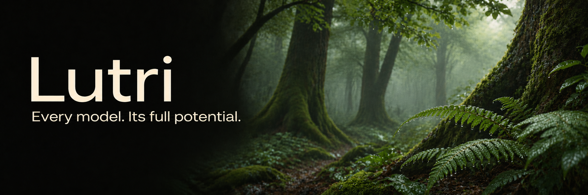
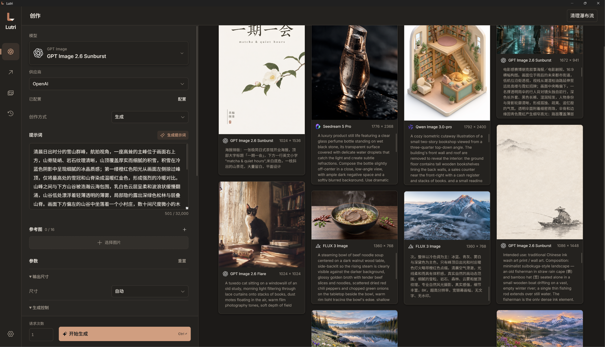

[English](README.md) · [简体中文](README-sc.md) · 日本語

# Lutri

> 一枚の良い絵は、一つの善行に等しいものであるべきだ。

—— フィンセント・ファン・ゴッホ、[アルベール・オーリエへの手紙](https://www.webexhibits.org/vangogh/letter/20/626a.htm)

---

*Every model. Its full potential.* 🖼️

Lutri は、クリエイターのためのデスクトップ AI 画像生成ワークベンチです。多彩な画像生成モデルとプロバイダーを集め、それぞれのモデルと API に合わせて個別に対応。プロンプト Writer で一つのアイデアからさまざまな表現を探り、内蔵のローカル超解像モデルで細部を磨けます。

**10 のモデルシリーズ · 15 のプロバイダー · 複数の AI 作家によるプロンプト Writer · 4 つのローカル超解像モデル**




## 多彩なモデル、一つひとつの API に合わせた設計

モデルには、それぞれ得意な表現や機能があります。Lutri は「モデル × プロバイダー」の組み合わせごとに、入力コントロール、パラメーターの範囲と既定値、参照画像の役割、生成・編集の処理経路、実際の API リクエストまで個別に対応しています。

| モデルシリーズ | 対応モデル |
| --- | --- |
| **FLUX** | FLUX 3 Image、FLUX 3 Image Klein |
| **GPT Image** | GPT Image 2.6 Flare、GPT Image 2.6 Sunburst、GPT Image 2.5 Flare、GPT Image 2.5 Sunburst |
| **Nano Banana / Gemini** | Nano Banana 2.1、Nano Banana 2、Nano Banana 2 Lite、Nano Banana Pro |
| **Seedream** | Seedream 5 Pro、Seedream 5 Lite、Seedream 5 Flash |
| **Qwen Image** | Qwen Image 3.0、Qwen Image 3.0-pro、Qwen Image 2.1-pro、Qwen Image 2.1-turbo |
| **Grok** | Grok Imagine Image 2.0 |
| **MAI Image** | MAI Image 2.6、MAI Image 2.5 |
| **Muse** | Muse Image |
| **Recraft** | Recraft v4.1、Recraft v4.1 pro、Recraft v4.1 utility、Recraft v4.1 utility pro、Recraft v4 styles、Recraft v4 styles pro |
| **Ideogram** | Ideogram 4.5、Ideogram 4.0 |

### プロバイダー

以下のプロバイダーとルーティングサービスに対応しています。普段の使い方、必要なモデル、利用中のアカウントに合わせて選べます。

**Black Forest Labs · OpenAI · Google · xAI · Meta · Microsoft Foundry · Recraft · Ideogram · QwenCloud · Volcengine · BytePlus · fal · OpenRouter · Runware · Comfy Router**

## プロンプト Writer ✒️

一つのアイデアから、さまざまな画面が生まれます。プロンプト Writer では、複数の LLM が同じ制作意図をもとに、それぞれのプロンプトを作成します。構図、光、スタイル、細部の表現を比べ、気に入った方向で制作を続けられます。

- **複数の作家が、それぞれの表現で。** 複数の言語モデルを設定して同じ入力から異なる案を作成できます。同じモデルで複数回試すこともできます。
- **経験を執筆ガイドラインに。** FLUX、GPT Image、Nano Banana、Qwen、Seedream などのプロンプトガイドラインと、文字組みのガイドラインを内蔵。自分の Markdown ファイルも読み込めるので、作風やプロジェクトの要件を蓄積できます。
- **表現を選んで、制作を続ける。** 個別の結果を再生成したり、選んだプロンプトを画像生成画面に戻したりできます。

Writer では OpenAI 互換の言語モデルサービスを独立して設定でき、使い慣れた AI 作家を選べます。

<!-- Writer のスクリーンショット：一つのアイデアから生まれた複数のプロンプト -->

## ローカル超解像 🔍

**第一印象の驚きから、細部の満足まで。**

Lutri は、写真、汎用画像、アニメ、イラストに対応する 4 つの超解像モデルを内蔵しています。モデルはアプリに同梱され、処理はローカルで完結するため、この工程で画像をアップロードしたり、クラウドの画像生成 API を呼び出したりする必要はありません。

| 内蔵モデル | 主な用途 |
| --- | --- |
| **Real-ESRGAN General** | 日常の写真や汎用画像向け。処理速度と GPU メモリ使用量のバランスがよく、一括処理にも適しています。使用モデルは `realesr-general-x4v3` です。 |
| **Real-ESRGAN x4plus** | 写真、風景、質感の豊かな画像向け。低解像度画像の質感や細部を改善します。 |
| **Real-ESRGAN x4plus Anime** | アニメ、イラストなどの描画画像向け。アニメの表現に最適化されています。 |
| **Real-CUGAN Pro** | アニメやイラスト向け。画像に合わせて、ノイズ除去なし・控えめ・強めを選べます。 |

単一画像と一括処理に対応し、画像ごとの進行状況を表示します。処理後は比較スライダーで元画像と結果を見比べ、気に入った仕上がりをエクスポートしたり、ギャラリーに保存したりできます。

Real-ESRGAN シリーズは 1×・2×・3×・4×、Real-CUGAN Pro は 2×・3× の出力に対応しています。GPU 推論には Vulkan 対応のグラフィックスドライバーが必要です。

<!-- 超解像の処理前後を比較：同じ画像の細部を表示 -->

## 一度の生成から、続いていく創作へ 🎨

使いやすいワークベンチは、試した後のことも支えます。

**まとめて試す。** 一度に複数の生成リクエストを送信し、画像生成画面で結果を確認できます。リクエストごとに複数枚を生成できるモデルでは、その枚数も設定できます。

**アイデアが生まれた場所に戻る。** 履歴は生成記録をバッチ単位で保存します。パラメーターと利用可能な参照画像を復元し、以前の試行を次の制作の出発点にできます。

**素材を、自分のコレクションへ。** 生成結果と参照素材をギャラリーで管理。お気に入りやカスタムボードで整理し、画像生成や超解像に再利用できます。

**AI アシスタントも制作に参加。** 内蔵のローカル MCP サーバーを通じて、モデルの照会、生成リクエストの送信、タスク結果の取得、ギャラリー素材の検索、ローカル超解像を実行できます。

**デスクトップで、心地よく。** 中国語・英語・日本語に対応。ライト、ダーク、システムに合わせるテーマを選べます。

## 一つのアイデアから始めよう 💡

1. 設定で、利用するプロバイダーの API キーを登録します。
2. モデルを選び、アイデアを書いたり、参照画像を追加したりします。
3. そのまま生成するか、まず Writer でさまざまな表現を探ります。
4. 気に入った結果をお気に入りに登録し、ローカル超解像で仕上げます。

クラウドでの画像生成と Writer は、設定したサービスを利用し、料金は各プロバイダーから請求されます。ローカル超解像にクラウド API のクレジットは不要です。

**次の、残しておきたい一枚は、ここから。**

---

## 開発とビルド

開発には Node.js 24 以降、npm、Rust が必要です。

```sh
npm ci
npm run dev       # フロントエンド開発
npm run app:dev   # デスクトップアプリ開発
npm run app:build # 現在のプラットフォーム向けのインストーラーをビルド
npm run typecheck
npm run format
npm run format:check
```

### サービスの設定

設定でプロバイダーのキーを保存した後、画像生成画面でモデルとプロバイダーを選びます。各組み合わせには、専用のフィールド、制約、リクエスト組み立て処理があります。Writer では OpenAI 互換モデルを別途設定します。エンドポイントには、必要に応じて `/v1` などを含むベースパスを指定し、`/chat/completions` は含めません。

MCP は設定から起動します。サーバーはローカルアドレスのみで待ち受けます。設定をコピーし、Streamable HTTP に対応するクライアントに追加してください。モデルの組み合わせの照会、バッチの送信、既存タスクの再開、ギャラリー画像の検索・読み取り、ローカル超解像を利用できます。

### ローカル超解像とプラットフォーム別ビルド

プロジェクトには Windows x64・Linux x64 用の NCNN ランタイムと、Real-ESRGAN・Real-CUGAN モデルが含まれています。対象プラットフォームに応じたランタイムを使用します。GPU 推論には Vulkan 対応のグラフィックスドライバーが必要です。関連ライセンスは `src-tauri/resources/upscale` にあります。
