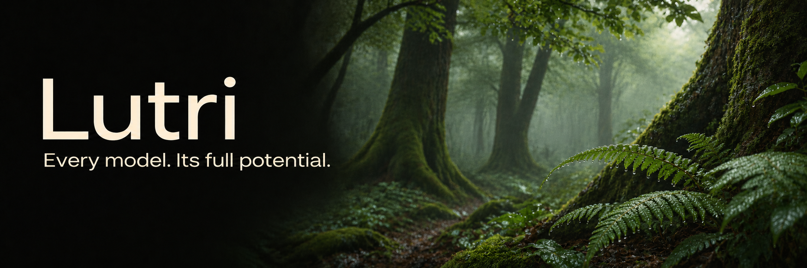
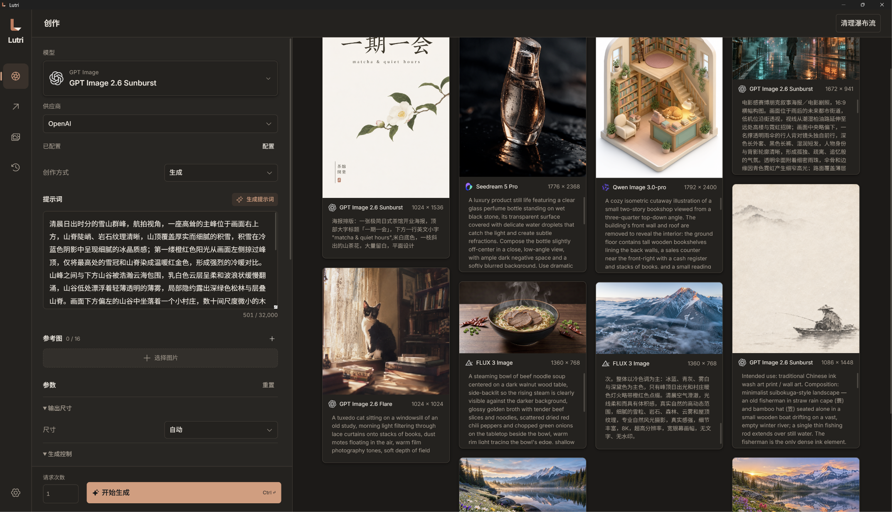

[English](README.md) · 简体中文 · [日本語](README-jp.md)

# Lutri

> 一幅好画，应当相当于一件善事。

—— 文森特·梵高，[致阿尔贝·奥里耶的信](https://www.webexhibits.org/vangogh/letter/20/626a.htm)

---

*Every model. Its full potential.* 🖼️

Lutri 是一款面向创作者的桌面 AI 图像生成工作台。汇集丰富的生图模型与供应商，为每个模型与 API 量身适配；通过提示词 Writer 探索同一个想法的不同表达，再用内置本地超分模型提升画面细节。

**10 个模型系列 · 15 个 Provider · 多作家提示词 Writer · 4 款本地超分模型**




## 丰富的模型，细致到每一个 API

不同模型有不同的表达方式和特长。Lutri 围绕每一个「模型 × Provider」组合进行定制适配：从输入控件、参数范围与默认值，到参考图用途、生成与编辑路径，以及最终的 API 请求。

| 模型系列 | 已接入模型 |
| --- | --- |
| **FLUX** | FLUX 3 Image、FLUX 3 Image Klein |
| **GPT Image** | GPT Image 2.6 Flare、GPT Image 2.6 Sunburst、GPT Image 2.5 Flare、GPT Image 2.5 Sunburst |
| **Nano Banana / Gemini** | Nano Banana 2.1、Nano Banana 2、Nano Banana 2 Lite、Nano Banana Pro |
| **Seedream** | Seedream 5 Pro、Seedream 5 Lite、Seedream 5 Flash |
| **Qwen Image** | Qwen Image 3.0、Qwen Image 3.0-pro、Qwen Image 2.1-pro、Qwen Image 2.1-turbo |
| **Grok** | Grok Imagine Image 2.0 |
| **MAI Image** | MAI Image 2.6、MAI Image 2.5 |
| **Muse** | Muse Image |
| **Recraft** | Recraft v4.1、Recraft v4.1 pro、Recraft v4.1 utility、Recraft v4.1 utility pro、Recraft v4 styles、Recraft v4 styles pro<br>**SVG:** Recraft V4 Vector、Recraft V4 Pro Vector、Recraft V4.1 Vector、Recraft V4.1 Pro Vector、Recraft V4 Styles Vector、Recraft V4 Styles Pro Vector |
| **Ideogram** | Ideogram 4.5、Ideogram 4.0 |

### Providers

支持以下供应商与路由服务，可以按自己的使用习惯、模型需求和账户配置选择：

**Black Forest Labs · OpenAI · Google · xAI · Meta · Microsoft Foundry · Recraft · Ideogram · QwenCloud · Volcengine（火山引擎）· BytePlus · fal · OpenRouter · Runware · Comfy Router**

## 提示词 Writer ✒️

一句想法，可以写成不同的画面。提示词 Writer 让多个 LLM 围绕同一个创作意图，分别生成提示词版本。你可以比较它们对构图、光线、风格与细节的表达，选择最喜欢的方向继续创作。

- **多个作家，各自发挥。** 配置多个语言模型，为同一份输入生成不同版本，也可以让同一模型多次尝试。
- **把经验变成写作规范。** 内置 FLUX、GPT Image、Nano Banana、Qwen、Seedream 等提示词规范，以及文字排版规范；也可以导入自己的 Markdown 文件，积累个人风格与项目要求。
- **选中表达，继续创作。** 对单个结果重新生成，或将选中的提示词一起带回创作页。

Writer 支持独立配置 OpenAI-compatible 语言模型服务，让你选择自己习惯的 AI 作家。

<!-- Writer 界面截图：同一想法的多个提示词版本 -->

## 本地超分辨率 🔍

**从整体的惊喜，到细节的满足。**

Lutri 内置四款超分辨率模型，覆盖照片、通用图像、动漫与插画。模型随应用提供，超分处理在本地完成，无需为这一步上传图片或调用云端生图 API。

| 内置模型 | 适用方向 |
| --- | --- |
| **Real-ESRGAN General** | 日常照片与通用图像，兼顾处理速度与显存占用，适合批量处理。对应模型为 `realesr-general-x4v3`。 |
| **Real-ESRGAN x4plus** | 照片、风景和纹理丰富的图像，用于改善低清画面的纹理与细节。 |
| **Real-ESRGAN x4plus Anime** | 动漫、插画与绘画图像，针对动漫内容优化。 |
| **Real-CUGAN Pro** | 动漫与插画，提供关闭、保守和强降噪选项，便于按画面情况调整。 |

支持单图与批量处理，每张图片独立展示任务进度。处理完成后，拖动对比滑块查看原图与结果，将满意的版本导出或保存到图库。

Real-ESRGAN 系列提供 1×、2×、3×、4× 输出选项；Real-CUGAN Pro 提供 2×、3×。GPU 推理需要支持 Vulkan 的显卡驱动。

<!-- 超分前后对比图：展示同一画面的局部细节 -->

## 从一次生成，到持续创作 🎨

好用的工作台，也照顾每一次尝试之后的事情。

**批量探索。** 一次提交多次生成请求，在创作页持续查看结果；支持单次多图的模型，还可以设置每次请求的生成数量。

**回到灵感发生的地方。** 历史按批次保留生成记录，可恢复参数与仍可用的参考图，让一次尝试成为下一次创作的起点。

**让素材逐渐成为自己的收藏。** 在图库中管理生成结果与参考素材，用收藏和自定义图板组织图片，再将它们送回创作或超分辨率流程。

**让 AI 助手加入工作流。** 内置本机 MCP 服务，支持查询模型、提交常规创作或云端批处理、按 asset ID 查找图库素材，以及获取历史任务结果。

**熟悉而舒适的桌面体验。** 支持中文、英文、日文，以及浅色、深色和跟随系统的主题。

## 从一个想法开始 💡

1. 在设置中配置所需 Provider 的 API 密钥。
2. 选择模型，写下想法，或添加参考图。
3. 直接生成，或先交给 Writer 探索不同表达。
4. 收藏喜欢的结果，用本地超分继续打磨。

云端生图与 Writer 使用你配置的服务，费用由对应供应商收取。本地超分无需云端 API 额度。


**下一张值得留下的图，从这里开始。**

---


## 开发与构建

开发环境需要 Node.js 24 或更高版本、npm 和 Rust。

```sh
npm ci
npm run dev       # 前端开发
npm run app:dev   # 桌面开发
npm run app:build # 当前平台的完整安装包
npm run typecheck
npm run format
npm run format:check
```

### 服务配置

在设置中保存供应商密钥后，在创作页选择模型及供应商。不同组合有各自的字段、约束和请求编译器。Writer 使用独立的 OpenAI-compatible 模型配置；端点填写到 `/v1` 等基础路径，不包含 `/chat/completions`。

MCP 在设置中启动，仅监听本机地址并使用 token 鉴权；复制配置后加入支持 Streamable HTTP 的客户端。Agent 可独立于当前草稿提交创作、搜索完整图库，并获取已保存的任务结果，包括未入库结果。参数、调用标识与使用流程见 [MCP 工具参考](doc/mcp.md)。接口已重写，原客户端需要刷新工具列表并调整调用。

### 本地超分与平台构建

本地超分随项目提供 NCNN Windows x64、Linux x64 运行库及 Real-ESRGAN / Real-CUGAN 模型，按目标平台选择运行库。GPU 推理需要支持 Vulkan 的显卡驱动。相关许可位于 `src-tauri/resources/upscale`。
