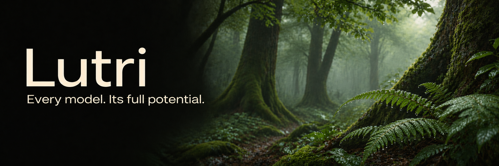
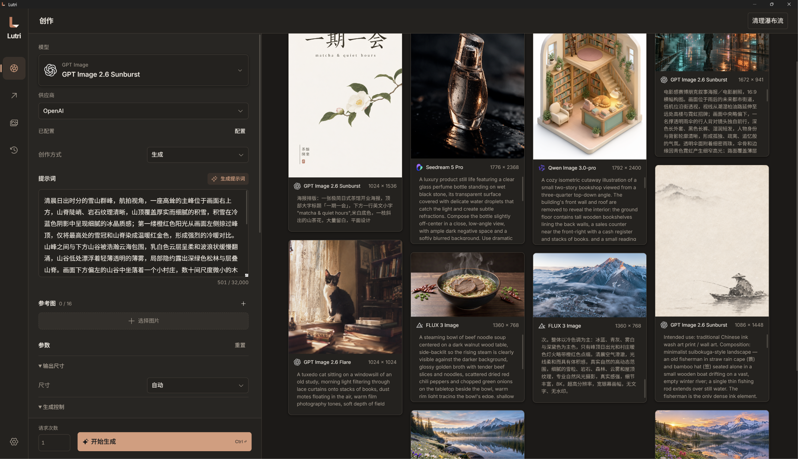

English · [简体中文](README-sc.md) · [日本語](README-jp.md)

# Lutri

> A good picture should be equivalent to a good deed.

— Vincent van Gogh, [Letter to Albert Aurier](https://www.webexhibits.org/vangogh/letter/20/626a.htm)

---

*Every model. Its full potential.* 🖼️

Lutri is a desktop AI image generation workbench for creators. It brings together a wide range of image models and providers, with integrations tailored to each model and API. Explore different ways to express an idea with Prompt Writer, then refine the details with built-in local upscaling models.

**11 model families · 15 providers · Multi-writer Prompt Writer · 4 local upscaling models**




## A wide choice of models. Attention to every API.

Each model has its own strengths and ways of interpreting an idea. Lutri tailors every model–provider combination, from input controls, parameter ranges, and defaults to reference image roles, generation and editing paths, and the final API request.

| Model family | Integrated models |
| --- | --- |
| **FLUX** | FLUX 3 Image, FLUX 3 Image Klein |
| **GPT Image** | GPT Image 2.6 Flare, GPT Image 2.6 Sunburst, GPT Image 2.5 Flare, GPT Image 2.5 Sunburst |
| **Nano Banana / Gemini** | Nano Banana 2.1, Nano Banana 2, Nano Banana 2 Lite, Nano Banana Pro |
| **Seedream** | Seedream 5.5, Seedream 5 Pro, Seedream 5 Lite, Seedream 5 Flash |
| **Qwen Image** | Qwen Image 3.0, Qwen Image 3.0-pro, Qwen Image 2.1-pro, Qwen Image 2.1-turbo |
| **Grok** | Grok Imagine Image 2.0 |
| **MAI Image** | MAI Image 2.6, MAI Image 2.5 |
| **Muse** | Muse Image |
| **Recraft** | Recraft v4.1, Recraft v4.1 pro, Recraft v4.1 utility, Recraft v4.1 utility pro, Recraft v4 styles, Recraft v4 styles pro<br>**SVG:** Recraft V4 Vector, Recraft V4 Pro Vector, Recraft V4.1 Vector, Recraft V4.1 Pro Vector, Recraft V4 Styles Vector, Recraft V4 Styles Pro Vector |
| **Ideogram** | Ideogram 4.5, Ideogram 4.0 |
| **MiniMax** | MiniMax H3-Image, MiniMax H3-Image HighSpeed |

### Providers

Choose from the following providers and routing services to suit your workflow, model needs, and accounts:

**Black Forest Labs · OpenAI · Google · xAI · Meta · Microsoft Foundry · Recraft · Ideogram · QwenCloud · Volcengine · BytePlus · fal · OpenRouter · Runware · Comfy Router · MiniMax**

## Prompt Writer ✒️

One idea can lead to many different images. Prompt Writer lets multiple LLMs write their own prompts from the same creative brief. Compare how they describe composition, lighting, style, and detail, then follow the direction you like best.

- **Multiple writers, different perspectives.** Configure several language models to produce different versions of the same input, or let one model try more than once.
- **Turn experience into writing guidelines.** Use built-in prompt guidelines for FLUX, GPT Image, Nano Banana, Qwen, and Seedream, along with typography guidelines. Import your own Markdown files to capture your style and project requirements.
- **Choose a version and keep creating.** Regenerate an individual result or bring your chosen prompt back to the creation workspace.

Writer supports independently configured OpenAI-compatible language model services, so you can work with the AI writers you prefer.

<!-- Writer screenshot: multiple prompt versions from the same idea -->

## Local upscaling 🔍

**From the first impression to the finest details.**

Lutri includes four upscaling models for photos, general images, anime, and illustrations. The models ship with the app and run locally, so this step requires no image uploads or cloud image generation API calls.

| Built-in model | Best suited for |
| --- | --- |
| **Real-ESRGAN General** | Everyday photos and general images. Balances speed and GPU memory use, making it a useful choice for batches. Uses `realesr-general-x4v3`. |
| **Real-ESRGAN x4plus** | Photos, scenery, and images with rich textures. Improves textures and details in low-resolution images. |
| **Real-ESRGAN x4plus Anime** | Anime, illustrations, and drawn images, with optimizations for anime content. |
| **Real-CUGAN Pro** | Anime and illustrations. Offers no denoising, conservative denoising, and strong denoising to suit the image. |

Process a single image or a batch, with separate progress for each image. Once processing is complete, drag the comparison slider to inspect the original and the result, then export your preferred version or save it to the gallery.

The Real-ESRGAN models offer 1×, 2×, 3×, and 4× output options; Real-CUGAN Pro offers 2× and 3×. GPU inference requires a graphics driver with Vulkan support.

<!-- Before-and-after upscaling comparison: details from the same image -->

## From a single generation to an ongoing creative process 🎨

A useful workbench also takes care of what happens after each experiment.

**Explore in batches.** Submit multiple generation requests at once and watch results appear in the creation workspace. Models that support multiple images per request also let you set the image count for each request.

**Return to where an idea began.** History keeps generation records grouped by batch. Restore parameters and available reference images to make an earlier experiment the starting point for your next creation.

**Build a collection of your own.** Manage generated images and reference materials in the gallery. Organize them with favorites and custom boards, then reuse them for creation or upscaling.

**Bring your AI assistant into the workflow.** A built-in local MCP server lets agents discover models, submit regular creation or cloud batches, find gallery assets by asset ID, and retrieve previous task results.

**Feel at home on your desktop.** Chinese, English, and Japanese interfaces, with light, dark, and system themes.

## Start with an idea 💡

1. Configure the API keys for your chosen providers in Settings.
2. Choose a model, describe your idea, or add reference images.
3. Generate an image directly, or explore different expressions with Writer first.
4. Favorite the results you love and refine them with local upscaling.

Cloud image generation and Writer use the services you configure, with charges handled by the respective providers. Local upscaling requires no cloud API credits.

**Your next image worth keeping starts here.**

---

## Development and builds

Development requires Node.js 24 or later, npm, and Rust.

```sh
npm ci
npm run dev       # Frontend development
npm run app:dev   # Desktop development
npm run app:build # Full installer for the current platform
npm run typecheck
npm run format
npm run format:check
```

### Service configuration

Save your provider keys in Settings, then select a model and provider in the creation workspace. Each combination has its own fields, constraints, and request compiler. Writer uses a separate OpenAI-compatible model configuration. Enter the base endpoint, including a path such as `/v1` where needed, without `/chat/completions`.

Start MCP in Settings, then copy its configuration into a client that supports Streamable HTTP. The server listens only on a local address and requires its bearer token. Agents can create independently of your drafts, search the complete gallery, and retrieve saved task results, including results outside the gallery. See the [MCP tool reference](doc/mcp.md) for parameters, request IDs, and workflows. Existing clients must refresh their tool list and update calls to the rewritten interface.

### Local upscaling and platform builds

The project includes NCNN runtimes for Windows x64 and Linux x64, along with Real-ESRGAN and Real-CUGAN models. The runtime is selected for the target platform. GPU inference requires a graphics driver with Vulkan support. Licenses are in `src-tauri/resources/upscale`.
